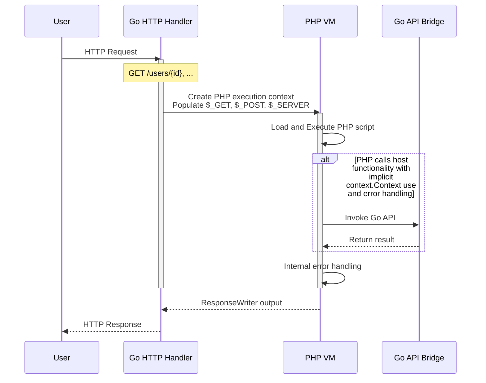
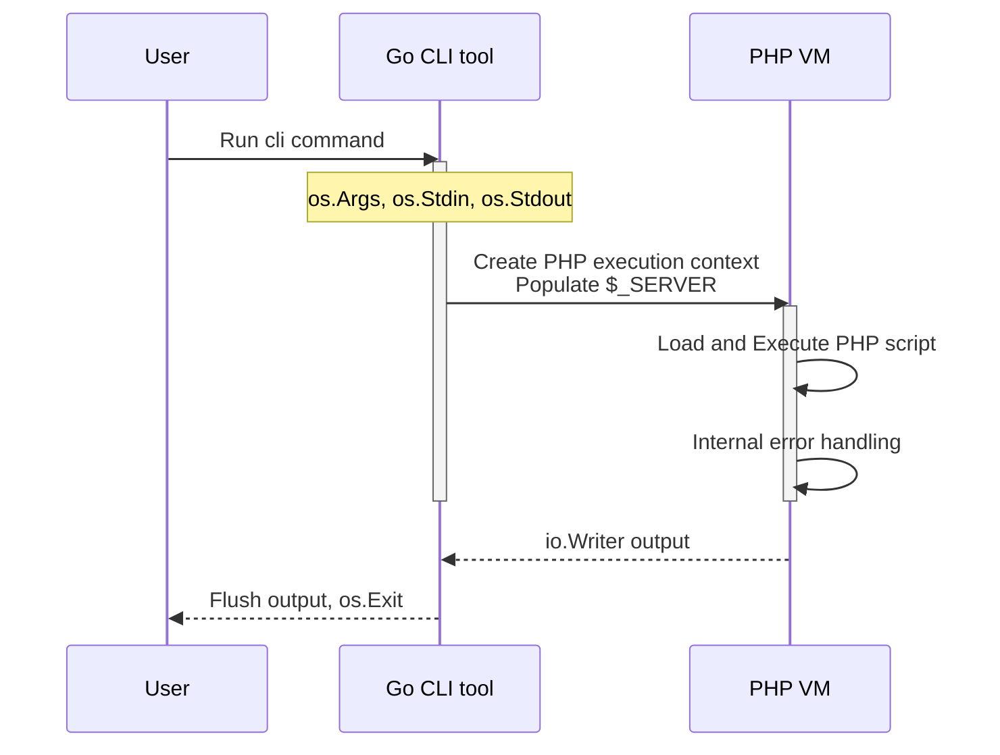

# About phpscript

The design of phpscript is to be a lightweight evaluator of php syntax. A subset of the standard library is available. The intent of the runtime is mainly focused on:

1. Bundling and using PHP as part of a Go service, embedding php assets to a binary
2. Interfacing type safe Go code with PHP as an "intra-process" execution bridge

For the runner-compatible compile-once bytecode backend, see [Flat-stack runtime](./flatstack.md).

This allows the two use cases above. It does not support running most open source PHP projects that use advanced syntax the runtime does not have.

## HTTP requests



The PHP runtime manages internal go errors through `try`/`catch` statements. Any error returned by a function in the API bridge results in a PHP runtime exception.

The Go side can bind many APIs and runs them natively. Implicit context propagation and error handling makes storage or repository packages usable without any go code changes required.

You can start a vanilla server with `phpscript server`, but the intent is that you integrate the PHP VM in your Go application.

## CLI execution



You can run PHP scripts from the command line with `phpscript <file.php>` or with a shebang:

```php
#!/usr/bin/env phpscript
<?php

echo "Hello world\n";
```

The CLI can bundle internal APIs for PHP, but the script binary then adds the bindings the API bridge calls.

## Known divergences from PHP

Variable types are dynamic, as in PHP. phpscript refuses run-time enforcement of one-type-per-name: existing code retypes variables freely, and the cost of fixing it outweighs the guarantee. The convention survives as an advisory `phpscript lint` finding ("no reassignment: $a already declared as string") that flags a literal reassigning a variable at another type without failing the run. The runtime behaves exactly as PHP does, pinned on each engine by `tests/fixtures/types/` with php as the oracle.

`phpscript run` ends on SIGINT and SIGTERM, and reloads on SIGHUP: cancelling its context ends the running generation, its shutdown callbacks run, and `phpscript run` reads the file again. php has no reload - a CLI script ends on a signal and that is all - so this is an addition and not a divergence. It makes a script that serves usable from a terminal.

An `HTTP\Mux` handler is a callable: a closure, a method read from its receiver, spelled `$this->fnName` or `$this->fnName(...)`, an object declaring `__invoke`, the name of a declared function, or `"Class::method"` and `Class::method(...)`. `$obj->name` without parentheses answers the property of that name. Where the class declares a method instead and the property is absent, it answers that method bound to `$obj`. That is the value the first-class callable syntax `$obj->name(...)` answers here and in php, and the value `get_class()` names a Closure. The divergence is the shorter spelling, which php reads as an undefined property and warns on. php and phpscript write `$obj->name(...)` the same and mean the same thing. See [First-class callable syntax](reference/functions/README.md#first-class-callable-syntax). The router does not accept two array spellings: `array($object, "method")` and `array("Class", "method")`. They stay callable everywhere else - `call_user_func`, `usort`, a Go binding's callback and the rest take them. phpscript will not add such a spelling. A handler is a function of its arguments, and wrapping one in an array to name a method is a spelling this does not want, now that `(...)` writes the same thing. Every request answering through a handler shares that handler's capture, `$this` included, because each request runs on a separate runtime and the capture is not copied. Read it. Writing to it from a handler is two requests writing to one value. A static handler captures nothing, the receiver being an empty instance built per call.

A handler answers on a dedicated worker runtime. A callable the script built before the server started runs on that worker when a handler calls it. Value and execution differ: the value crosses, the execution does not. The values a handler reaches, the values a fork passes, and the spellings the router refuses are in [use-cases/http-server.md](use-cases/http-server.md).

`error_log` records $message and answers true, and takes only the message: php's $message_type, $destination and $additional_headers choose between destinations and are not implemented. phpscript picks the destination the way php lets the SAPI decide - the trace of the request it serves, the handler a Go host installed through `Runtime.OnError`, and the process error stream when there is neither.

The execution-limit functions answer in phpscript's types where php uses different types. `set_time_limit(int $seconds): bool` agrees with php. `connection_aborted(): bool` answers a bool where php answers `int` 1 or 0. `ignore_user_abort(bool $enable)` returns nothing, where php's signature answers the previous setting. Called without an argument it leaves the setting alone and reads nothing back. `if (ignore_user_abort())` is always false here and guards nothing. A script that tests either with `==` reads the same. A script that does arithmetic on the returned value, or calls `ignore_user_abort()` to read the setting, does not. Neither `connection_status()` nor the `CONNECTION_*` constants exist here. Running out of time is a fatal, as in php: no `catch` intercepts it, nothing after it runs. `register_shutdown_function` callbacks do run, with the clock off. The limit is the runtime's wherever a script sets it, including inside an `HTTP\Mux` handler: a serving script stays one script while a handler moving the deadline moves the server's. The request scopes its connection and its `ignore_user_abort` setting, both reset when the handler returns. `tests/fixtures/runtime/execution_limits.phpt` pins each of them.

`sleep()` and `usleep()` end early when the script runs out of time or the client it answers goes away, because the wait is on the runtime context and not on the clock alone. Otherwise nothing could stop a script inside a wait it already had no time for. `sleep` still answers 0 in that case, where php answers the seconds left unslept when a signal cut it short. A negative count throws, as php does.

Declared types are not checked. The parser reads parameter, return, and property types. The formatter prints them back and the linter reads them. No run-time check reads any of them: `function takes(int $n)` called with `"not an int"` binds the string, and `function answers(): int` returning `"twelve"` answers the string. PHP checks both on every call and raises `TypeError: takes(): Argument #1 ($n) must be of type int, string given`, a fatal the script does not survive. The hint is documentation here. A class hint naming a class that does not exist is not an error, because nothing resolves it. This follows from variable types being dynamic, directly above: no declaration binds a name to the caller's type. `tests/fixtures/types/param_type_hints.phpt` pins it.

Strings count bytes in the str* functions and in the `$s[$i]` offset syntax. The mb_* functions count characters, which is PHP's own split. `strlen("héllo wörld")` is 13, `substr` and `substr_replace` can cut inside a character, the strpos family takes and reports byte offsets, while `strtoupper`, `strtolower`, `ucfirst`, `lcfirst` fold A-Z and leave the other bytes alone. `mb_strlen`, `mb_substr`, `mb_strpos`, `mb_str_split`, `mb_str_pad`, `mb_substr_count`, `mb_strtoupper`, `mb_strtolower`, `mb_ucfirst` and `mb_lcfirst` are the character-counting half, and `mb_strlen($s, "8bit")` answers in bytes for binary data returned by `hash($algo, $data, true)`. One unit across the two families makes an offset usable: `PREG_OFFSET_CAPTURE` reports byte offsets and `substr($s, $offset)` reads the match back, and `mb_substr` needs `mb_strlen(substr($s, 0, $offset))` first. The linter flags `$s[$i]` as advisory drift towards `mb_substr()` where the code means a character. `tests/fixtures/strings/byte_and_character_units.phpt`, `byte_offset_edges.phpt` and `tests/fixtures/regex/preg_offset_capture_substr.phpt` pin this with php.

Arithmetic follows PHP semantics: int/float coercion, overflow to float, precision-14 float rendering, and `DivisionByZeroError` out of `/` and `%` on a zero divisor, in whatever shape the zero arrives, an int, a float, a numeric string, `false` or `null`. `intdiv()` throws the same class and `fdiv()` answers `INF`, `-INF` or `NAN`, as in PHP. A single clause misses the throw: `catch (ArithmeticError $e)`, the class php files `DivisionByZeroError` under. See Classes below. `tests/fixtures/arithmetic/divide_by_zero.phpt` pins the rest.

Comparison follows PHP 8's table: `==` and `!=` coerce across types. `"1" == 1`, `null == false` and `"1" == "01"` are true. A non-numeric string never compares numerically (`"abc" == 0` is false). `<`, `<=`, `>` and `>=` read the same table, while `===` and `!==` test identity and do not coerce. `switch`/`case` and `in_array()` apply the same rules. `<=>` answers -1, 0 or 1 by the same table.

The bitwise operators `&`, `|`, `^`, `<<`, `>>` and `~` follow PHP's precedence and semantics: the runtime casts operands to int, `&`/`|`/`^` between two strings work byte by byte and return a string, shifts are int64 operations where a count of 64 or more produces `0` (or `-1` for `>>` on a negative left operand). A negative shift count raises the same `ArithmeticError` PHP raises. Two divergences:

- phpscript casts an operand PHP 8 refuses outright. `~null` answers `-1`, `~true` answers `-2`, where PHP raises `TypeError`. An array operand of a binary bitwise operator counts as `0`, where PHP raises `TypeError: Unsupported operand types`.
- Casting a leading-numeric string (`"12abc" & 3`) does not emit PHP's "A non-numeric value encountered" warning. The value is the same.

A file that imported `Runtime\Go` holds typed values, a kind of value php does not have: `int8(300)` answers an int8 and `var_dump` names the width, `int8(44)` where php prints `int(44)`. Arithmetic over such a value keeps the width and wraps in it, as go's does. Two different widths answer a `TypeError`. The import admits such values. A file without the import holds php's own types alone, var_dump included. See [the go runtime](reference/extensions/go-runtime.md#typed-values).

Memory reporting differs from PHP's allocator view:

- `memory_get_usage()` estimates the payload of live PHP values by walking every execution frame and absolute numbers are far below PHP's (no zval or allocator overhead). Relative behavior matches: growth, `unset`, and frame release move the number the way PHP's does.
- `memory_get_peak_usage()` reports a peak the runtime samples at walk points (usage calls and `memory_limit` checkpoints). An allocation both made and released between walks does not raise the peak, unlike PHP's allocator-level high-water mark.
- Exceeding `memory_limit` raises a catchable `RuntimeException` where PHP treats it as a fatal error `catch` cannot intercept.

Superglobals:

- `$_REQUEST` merges the route's path values over the query, form and cookie fields. A `// @route GET /users/{id}` endpoint reads `$_REQUEST["id"]`. PHP's `$_REQUEST` holds no route parameters, which arrive under PHP's name and nothing here spells `$_PATH`, a name PHP does not have. See [Predefined variables](reference/predefined-variables/README.md#_request).

Strings:

- The runtime clamps a negative `$offset` past the start of the subject, a `substr_count()` window outside the subject, a `str_split()` length below 1 and an empty `str_pad()` pad string, where PHP 8 raises `ValueError`.
- `substr_replace()` does not accept array arguments.

Functions:

- Declaring a function twice, or redeclaring a name the runtime registers, raises a catchable `Exception`. PHP treats it as a compile-time fatal error no `catch` can reach. A script that includes a file which redeclares can answer for it here. There it cannot. `memory_limit` and an undefined constant diverge the same way. The first declaration stands and the program keeps running, while `phpscript lint` reports the condition before the file is ever hoisted.
- The message is PHP's, word for word, except for the paths in it. PHP prints host paths (`/srv/app/lib/helpers.php`), where a runtime that may serve its scripts out of an `fs.FS` has no host path to print. Both paths are the ones the script named, resolved against the root the host binds the shims to, including each subdirectory. `__FILE__` and `__DIR__` answer the same way and for the same reason.
- The runtime honours only a declaration written at the top level of a file. A `function` inside an `if` body or another function parses and confers nothing and `if (!function_exists('f')) { function f() {} }` leaves `f` undefined. The linter does not report this yet.

Processes:

- `exec()`, `system()`, `passthru()` and `shell_exec()` run a command through `sh -c`, as PHP's do, and **leave the sandbox behind**. A process reads and writes with the permissions of the user running the server. `writable_paths` and the source filesystem's root do not reach a process. A host that runs untrusted scripts leaves `stdlib/pexec` out. The runtime names where a command starts: the working directory `chdir()` moved, resolved onto the host. A relative path means the same thing to the command and to the script that ran it.
- `shell_exec()` answers `null` for a command that produced no output, as PHP does, which is also its answer for one that could not start. `exec()` appends to `$output`, as PHP's does.
- The `proc_*` family is not implemented. It needs a process handle and pipe resources `fopen()` can work with. The runtime has no such value.

Mail:

- `mail()` takes three arguments and **throws** where PHP's answers `false`. PHP's returns a bool and takes `$additional_headers` and `$additional_params`, which phpscript refuses: they let a script set the `From`, `Cc` and envelope headers, and those belong to the server the host configured. An application needs two: an HTML part plus a `Reply-To`, the optional fourth and fifth arguments of `Mail::send()`. A caller that needs PHP's shape wraps the call. The throw names the reason, where PHP's `false` says nothing.
- There is no `sendmail_path` and no local MTA. Every delivery goes to a server named in the [`mail` block](configuration.md#mail-servers), and `mail()` uses the server called `default`. Without a configured server the call still exists, and throws naming the server it looked for.
- A script cannot supply or read a credential. `new Mail($name)` selects a configured server by name, and the object it returns has no properties and nothing here builds a mailer out of settings a script holds. See [Credentials stay with the host](configuration.md#credentials-stay-with-the-host).

Filesystem:

- `glob()` searches the source filesystem. `glob("/etc/host*")` lists `etc/host*` inside the root. The host's `/etc` stays out of reach. A pattern that climbs stops at the root. Matches come back in the pattern's own shape, as PHP's do. `glob()` takes no `$flags` argument, leaving `GLOB_BRACE` and the rest undefined. See the path rules under Includes.
- `php://memory` and `php://temp` share one buffer no file ever backs. `php://temp` takes the `maxmemory:N` suffix and does not spill to a file, a difference no call through the handle API reports. `php://output` is the script's own output and `php://input` the request body. `php://stdout`, `php://stderr`, `php://fd` and `php://filter` are not bound, and `fopen()` answers `false` where PHP opens them. `feof()` keeps PHP's rule on every handle `fopen()` returns, files included: the read that ran out of bytes raises the end, a seek to the end leaves the handle open, a seek lowers the flag again. A handle a binding supplies as a bare `*os.File`, `STDOUT` among them, holds no such flag and reads as open.
- `opendir()` takes no `$context` argument, because there are no stream contexts to pass. The handle it returns holds the listing, without an open directory behind it. Source filesystems an embedded application ships have no descriptor to hold. `readdir()` and `closedir()` require that handle. PHP falls back to the last directory `opendir()` opened, which needs a global the runtime does not keep. Names come back sorted, `"."` and `".."` first, as `scandir()` answers. PHP's `readdir()` answers in the directory's own order, and a script that depends on an order sorts either way. Reading a handle after `closedir()` reports the end of the listing, where PHP throws.

Arrays:

- `array_shift()`, `array_unshift()`, `array_pop()`, `array_push()` and `array_splice()` require a script array. They resize their argument. A Go slice cannot grow through the interface value that holds it. Native slices a binding returned (`explode()`, `array_keys()`) are an error, because no mutation happens that the script cannot observe. Assign it to a variable built by the script first: `$parts = array_merge(explode(",", $s));`.
- `unset($list[$i])` on a native slice renumbers the elements after it, matching `array_values()`. PHP leaves a hole and keeps the keys around it. `unset($e[1])` on a three-element list answers keys `0,2` there, `0,1` here, and `json_encode()` writes an object where this writes an array. `count()` and `implode()` read the same, including a `foreach` over the values. A script array keeps PHP's numbering. A list a binding keyed by position, `map[int]string`, does too: a map holds the hole a slice cannot.
- `unset($map[$key])` removes the key from a native map, a `Database` row or a `get_defined_functions()` result, as PHP does. A missing key is not an error.
- `compact()` returns a native map. A `foreach` over the map visits the names in an order Go picks and picks again on the next run. PHP visits them in the order the call names. The [allocation rules](allocation-performance.md) have a binding return a map, and nothing about compact promises an order. A script that needs one names its keys: `foreach (["title", "body"] as $k)`. The same holds for a `Database` row and for anything else a binding returns as a map.

JSON:

- `json_encode()` leaves a forward slash unescaped. PHP escapes it: `["path" => "a/b"]` is `{"path":"a\/b"}` there, `{"path":"a/b"}` here. Both are the same document to a parser, but a byte comparison or a signature over the encoded text is not. PHP produces this form with `JSON_UNESCAPED_SLASHES`, which is not defined here: the encoding takes no flags, see [design.md](design.md#json). `json_encode()` accepts a literal second argument and ignores it, while `JSON_*` names raise `Error`, since no constant defines them. `phpscript lint` reports that name first.

Constants:

- An undefined constant throws, as in PHP 8, and the class differs: `RuntimeException` here, `Error` there. An `Error` in PHP is a fault a caller is not expected to handle. A name this runtime does not define is a condition a script can answer for: `catch (Exception $e)` takes it, `catch (Error $e)` does not. `memory_limit` diverges the same way.
- An unset *variable* of the same spelling stays null and keeps running, which is PHP's behaviour and the reason the two are separate lookups. `global` is the exception: it stays a reserved word, the statement is a documented no-op, and the bare keyword answers null.

Namespaces:

- A file that declares a `namespace` may only declare classes and functions. PHP allows top-level statements there, while phpscript rejects them at parse time. The runtime scans an included namespaced file for the symbols it declares and never executes the file, which keeps resolving a name cheap. The runtime cannot treat a file with something to run that way. `use` and `declare` are preamble, not statements, and both are still allowed. Put executable code in a function, or in a file that declares no namespace.

Classes:

- `extends` on a class confers nothing. A class gets no members from its parent: no inherited methods, no inherited properties or constants, no `parent::` call, no constructor to fall back on. A catch clause and `instanceof` do not follow `extends`. The runtime does not check that the parent exists. A class that calls something it did not declare fails at the call, even though it parses and lints. Declare the members it uses. This is a decision. See [Design decisions](design.md).
- `phpscript lint` and the runtime check `implements`, which grants no members: a class must declare every method its interfaces name, or the linter reports the class, and the runtime raises a `RuntimeException`. An interface contributes no body, no property, no constant. A name no `interface` declaration in the same file defines is not a contract and is not checked and `implements Countable` loads: phpscript declares none of PHP's built-in interfaces.
- A constant declared on an interface resolves through the interface's own name, as a class constant does: `Hook::POSITION_PRE` answers on each engine and in the linter. An implementing class does not receive it. `Store::LIMIT` on `class Store implements Quota` fails as an undefined class constant where PHP answers it. `tests/fixtures/oop/interface_constants_not_acquired.phpt` pins the divergence.
- `instanceof` compares the class name, and an interface name against the list the class declared and `$a instanceof SomeInterface` is true for a class that implements the interface. No member follows `extends` on a class.
- A built-in throwable answers to its name, and to `Error` or `Exception` by the suffix of that name, which is the whole hierarchy a catch clause reads: `catch (DivisionByZeroError $e)` or `catch (Error $e)` takes a division by zero, `catch (ArithmeticError $e)` takes none, and `catch (LogicException $e)` does not take an `InvalidArgumentException`. `instanceof` reads the name alone and `$e instanceof Error` is false. The throwable hierarchy holds no parent table. See [Design decisions](design.md).
- The parser reads `abstract`, `final` and `readonly` on a class and the formatter prints them back. The runtime enforces none of these modifiers. A script can instantiate an abstract class, a final one restricts nothing, and a readonly class does not make its properties readonly.
- The parser names an anonymous class and `get_class()` answers `class@anonymous$1` where PHP answers a name built from the file and line that declared it. Neither spelling is a value to compare against. The bytecode engine does not compile an anonymous class, and a program containing one runs on the interpreter. See [Flat stack](flatstack.md).
- `phpscript fmt` refuses a file containing an anonymous class and leaves it untouched, because the printer would emit the synthesized name in place of the declaration.

Objects:

- `foreach` over an object visits every property. PHP visits only the ones visible where a script writes the loop. phpscript enforces no visibility anywhere and keeps no visibility to filter by. `(array)` and `get_object_vars()` read every property for the same reason.
- `(array)` on an object uses the plain property name. PHP prefixes a private name with the declaring class, a protected name with `*`, both wrapped in NUL bytes. A key holding a NUL byte is a key no script could index.
- `(object)` shares the array it converts. PHP copies it, because arrays are values there and handles here. The cast is not the place to make one exception to that. See [Value semantics](reference/types/value-semantics.md).
- `==` between two objects compares more than the properties: each object's first variable, and the order its properties arrive in. Two separately built objects with equal properties are unequal where PHP says they are equal, once differently named variables hold them or they arrive in a different order. `===` is identity, as in PHP.

Includes:

- `include` and `require` abort the request when the runtime cannot load the file, while PHP `include` emits a warning and continues.
- Nested `class` declarations do nothing and register nothing, matching the interpreter hoist, while PHP registers them when the statement runs.
- A relative path resolves against the working directory only. PHP tries the working directory, `include_path` after it, and finally the directory of the file doing the including. The last of those lets `include "b.php"` from `a/x.php` find `a/b.php`, where this runtime finds nothing. `set_include_path()` is the SPL autoloader's path and takes no part in `include`.

Paths and the working directory:

- The runtime mounts the source filesystem at `/`. `__FILE__` reads `/public/index.php` where PHP would say `/srv/site/public/index.php`, `__DIR__` is `/public`, and `getcwd()` answers `/` or `/app`. There is no spelling that reaches the host filesystem. A runtime that serves its scripts out of an embedded tree has no host path to name. `/` is the root the script can address, and a path that would climb above it stops there. `file_get_contents("/etc/passwd")` reads `etc/passwd` inside the root, or nothing.
- A path written from `/` ignores the working directory, which is PHP's rule for an absolute path. That rule makes `include __DIR__ . "/x.php"` name one file wherever `chdir()` has been, and the runtime spells the constants that way for the same reason.
- `chdir()` moves this request's working directory alone. The working directory is per-runtime state, a request has a runtime to itself while it runs, and the reset between requests puts the directory back. A script cannot move another request's, and the process working directory is never touched. `chdir()` answers `false` for a directory that does not exist, as in PHP, without the warning PHP also emits.
- An uploaded file is the exception. The runtime writes it outside the root and returns the `tmp_name` it wrote. Reading that path back reads a file the runtime produced. A path the request's upload registry did not issue is not an uploaded file, and `is_uploaded_file()` answers that check.
